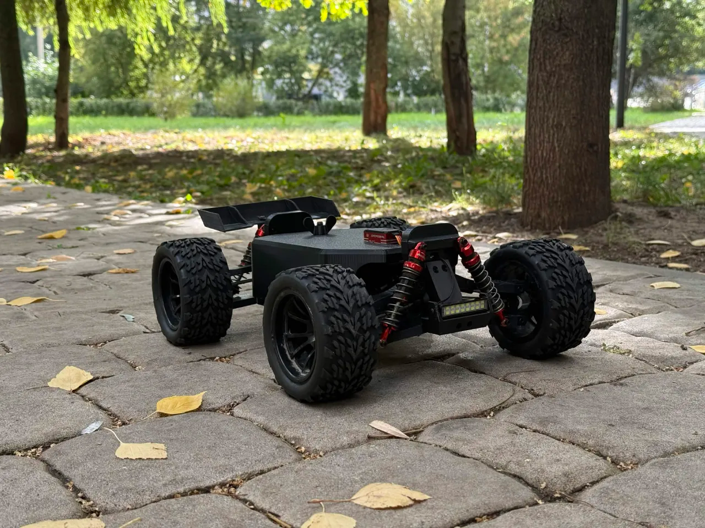

# Robak Unstoppable Dream Edition

An open-source 3D Printed RC truggy with metal drivetrain.

The most resilient RC car on the planet! More driving and less repairing. This vehicle only stops when your battery is empty. If you break this monster after flying out of your apartment window I failed.

[Bill of Materials and Printing Instructions](https://docs.google.com/spreadsheets/d/1WngvrndMor4qRpjjS1Nden6RAWPPBa2J9SWaNV3pnVo/edit?usp=sharing)

[Assembly Guide](https://docs.google.com/presentation/d/1uc42ykA9YBD8isIoi1eW3QIydnOAwHwjOqGhsE2rHdI/edit?usp=sharing)

[Model in CAD (Onshape)](https://cad.onshape.com/documents/217738c328698a5c23f3d09a/w/c96cb8ad98f287f59ddd623a/e/1a525c4f4641eb68ca207103?renderMode=0&uiState=6abf79b5775cfac698ec1bf2) from @ambrmart

## 4th of May 2026 v2.0 RELEASE
V2.0 offers superior handling due to direct steering (see last v1.1 review below). It also offers a superior drivetrain with the optional center differential. In addition it has newly designed front arms that remove play in front wheel alignment and make installation of smaller wheels possible. Motorplates have more space for pinion gears. The chassis can be printed in two pieces so most printers should be able to print RUDE.

## FAQ

#### What is this car going to cost me?

Complete hardware kit without plastic parts: Low budget: €200. Premium: €400. The BOM lists all premium parts. Compared to similar-spec commercial RC vehicles, RUDE is half the price.

Also maintenance cost is much lower, since a commercial crown gear costs around €30 to replace. Meanwhile RUDE complete differential incl. crown gear, spider gears and more cost only €4.

#### Is this car child friendly?

No, this toy is an absolute weapon.

## v1.1 reviews

> "10/10"

> "this car is freakin awesome"

> "Super fun project"

> "I just could not bring myself to buy him a crappy off the shelf RC car for Christmas. So he got a RUDE"

> "Just can’t stop driving it!"

> "it is a beast"

> "behaves like a jelly bear"

Join discord for more...

RUDE **v1.0** was a heavily modified version of [Robak v2.2](https://github.com/robaki-dev/robak/).
